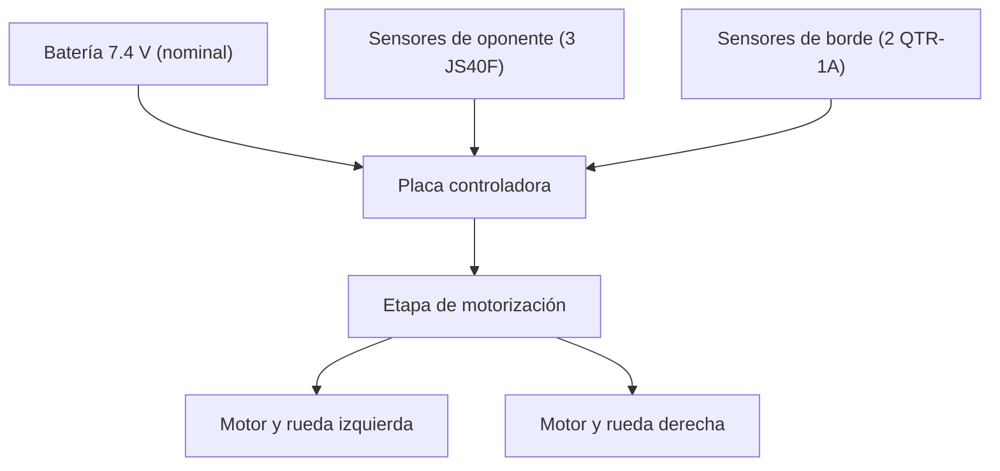

# Misión y arquitectura del equipo — Tormenta Negra

**Plataforma:** M01 · Mini-sumo autónomo  
**Dōjō:** Laboratorio de Electrónica, CTA, Campus León  
**Estado de referencia:** montaje y funcionamiento final al 30 de octubre de 2026. [E5](entregables/dia-05.md) y [fotografías del robot terminado](../evidencias/dia-05/README.md).

## Objetivo verificable

Construimos un mini-sumo autónomo capaz de desplazarse, reaccionar al borde y detectar un rival. En E5 realizamos tres pruebas y dos peleas contra otro mini-sumo; obtuvimos una victoria y una derrota en las peleas. Continúa pendiente mejorar la detección lateral y el control de parada.

## Arquitectura observada y prevista

| Subsistema | Función | Entradas | Salidas | Responsable / alcance |
|---|---|---|---|---|
| Mecánica | Sostener y ubicar los componentes en la base metálica | Base, soportes, ruedas, motores, placa y batería | Estructura y carcasa 3D montadas; dimensiones 10 × 10 cm; peso sin medir | Max y Joel · MS01 |
| Alimentación | Suministrar energía al control y a los motores | Batería etiquetada 7.4 V / 500 mAh, USB para programación | Alimentación reportada funcional con batería; especificaciones eléctricas por confirmar | Equipo · MS03 |
| Sensores de oponente | Detectar objetos frente y a los lados | Tres sensores JS40F reportados | JS40F integrados en V1/V2; detección lateral con fallas en algunas pruebas | Sara y Joel · MS06 |
| Sensores de borde | Detectar cambios de reflectancia sobre la pista | Dos sensores QTR-1A reportados | QTR integrados, calibración y evasión probadas en E4 | Equipo · control de borde |
| Control | Leer sensores y producir órdenes para los motores | Señales de sensores, programa cargado desde Arduino IDE | Programación autónoma de búsqueda y ataque E5 desarrollada por Joel | Joel (programación); equipo (integración) |
| Motorización | Mover el robot | Driver/controlador y batería | Motores y maniobras funcionales; respuesta ante rival documentada en E5 | Claudio, Sara y Max · MS03 |

## Flujo de señales (esquema funcional)

**Alcance del diagrama:** es funcional, no sustituye un esquema eléctrico ni la comprobación de voltajes. Los pines de la lógica E5 están documentados en sus archivos de código; la compatibilidad eléctrica debe confirmarse antes de nuevos ensayos.

## Dependencias y próximos pasos

- Medir el prototipo completo y comprobar límites del reglamento, rigidez y fijaciones.
- Guardar el firmware y el pinout realmente utilizados en la prueba.
- Registrar ensayos repetibles de giro y lectura de sensores en [ensayos.csv](../datos/ensayos.csv).
- Validar inicio/paro, reacción al borde y búsqueda/ataque en dōjō con autorización.
- Conservar evidencia fotográfica en [Día 3](../evidencias/dia-03/README.md).

**Participación y resultados:** [E2](entregables/dia-02.md), [E3](entregables/dia-03.md), [E4](entregables/dia-04.md) y [E5](entregables/dia-05.md) describen el trabajo del equipo y enlazan las bitácoras personales.
