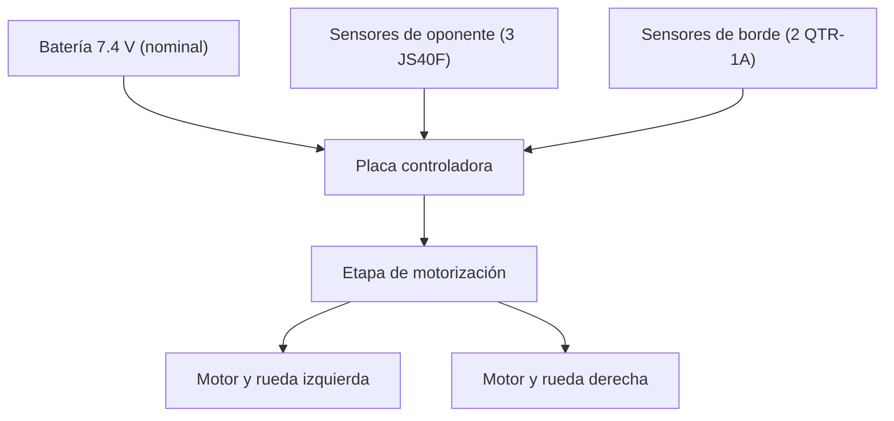

# Misión y arquitectura del equipo — Tormenta Negra

**Plataforma:** M01 · Mini-sumo autónomo  
**Dōjō:** Laboratorio de Electrónica, CTA, Campus León  
**Estado de referencia:** 28 de octubre de 2026; [entregable E3](entregables/dia-03.md).

## Objetivo verificable

Construir un robot mini-sumo autónomo que pueda desplazarse, detectar al oponente, identificar el borde blanco del dōjō y reaccionar de forma segura. Las pruebas exploratorias de motores y sensores se reportaron correctas; el comportamiento autónomo integrado no se ha ensayado todavía.

## Arquitectura observada y prevista

| Subsistema | Función | Entradas | Salidas | Responsable / alcance |
|---|---|---|---|---|
| Mecánica | Sostener y ubicar los componentes en la base metálica | Base, soportes, ruedas, motores, placa y batería | Estructura físicamente montada; dimensiones/peso por validar | Max y Joel · MS01 |
| Alimentación | Suministrar energía al control y a los motores | Batería etiquetada 7.4 V / 500 mAh, USB para programación | Alimentación reportada funcional con batería; especificaciones eléctricas por confirmar | Equipo · MS03 |
| Sensores de oponente | Detectar objetos frente y a los lados | Tres sensores JS40F reportados | Señales hacia el controlador; respuesta cualitativa reportada | Sara y Joel · MS06 |
| Sensores de borde | Detectar cambios de reflectancia sobre la pista | Dos sensores QTR-1A reportados | Lectura analógica al controlador; respuesta cualitativa reportada | Equipo; asignación detallada pendiente |
| Control | Leer sensores y producir órdenes para los motores | Señales de sensores, programa cargado desde Arduino IDE | Comandos de motor; estrategia autónoma aún pendiente | Claudio · MS07 y MS10 |
| Motorización | Mover el robot | Driver/controlador y batería | Giro observado de dos motores con batería; maniobras sobre pista por medir | Claudio, Sara y Max · MS03 |

## Flujo de señales (esquema funcional)

**Nota:** el diagrama es funcional, no un esquema eléctrico ni un pinout validado. Los pines exactos, el regulador y las rutas de alimentación deben confirmarse con documentación de la tarjeta y mediciones.

## Dependencias y próximos pasos

- Medir el prototipo completo y comprobar límites del reglamento, rigidez y fijaciones.
- Guardar el firmware y el pinout realmente utilizados en la prueba.
- Registrar ensayos repetibles de giro y lectura de sensores en [ensayos.csv](../datos/ensayos.csv).
- Validar inicio/paro, reacción al borde y búsqueda/ataque en dōjō con autorización.
- Conservar evidencia fotográfica en [Día 3](../evidencias/dia-03/README.md).

La atribución precisa del montaje del Día 3 a cada integrante sigue pendiente de su bitácora personal.
