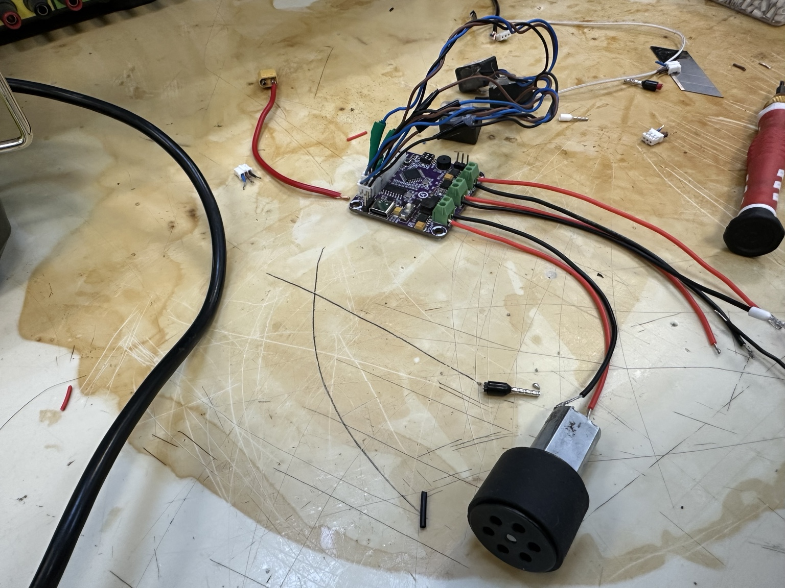
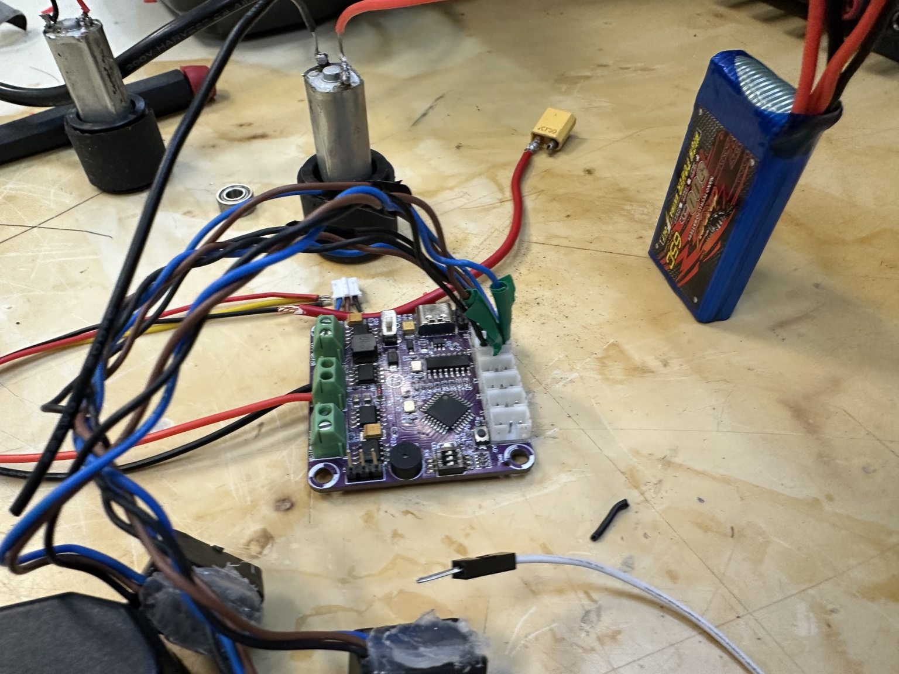
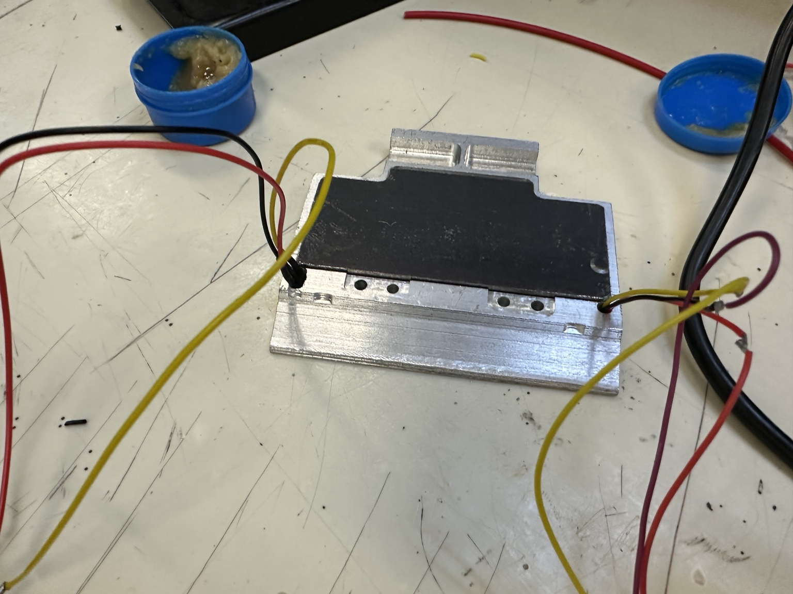
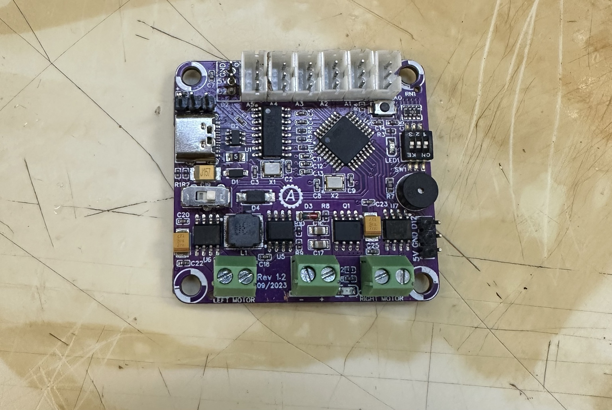

# Evidencias fotográficas · E2, 27 de octubre de 2026

**Equipo:** Tormenta Negra · **Lugar:** Laboratorio de Electrónica, CTA.

Las fotografías fueron tomadas por Joel durante el trabajo de conexión de sensores, motores y placa controladora.

### Conexiones de la placa y un motor

### Dos motores, batería y placa controladora

### Pieza metálica del montaje

### Vista detallada de la placa

**Archivos:** [IMG_3585.jpg](IMG_3585.jpg) · [IMG_3584.jpg](IMG_3584.jpg) · [IMG_3583.jpg](IMG_3583.jpg) · [IMG_3580.jpg](IMG_3580.jpg)

El montaje y las pruebas continuaron en [el E3 del equipo](../../docs/entregables/dia-03.md). El registro de actividades del 27 de octubre está en [E2](../../docs/entregables/dia-02.md).
