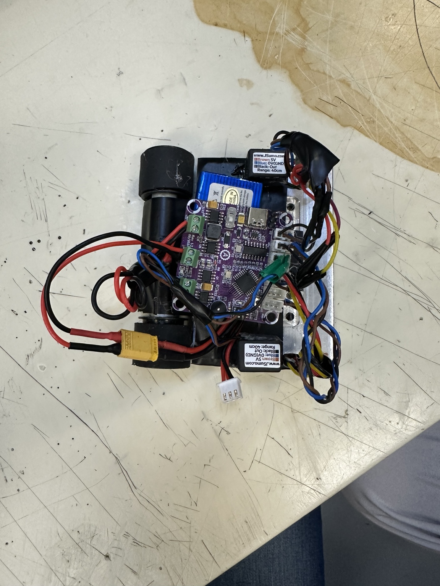
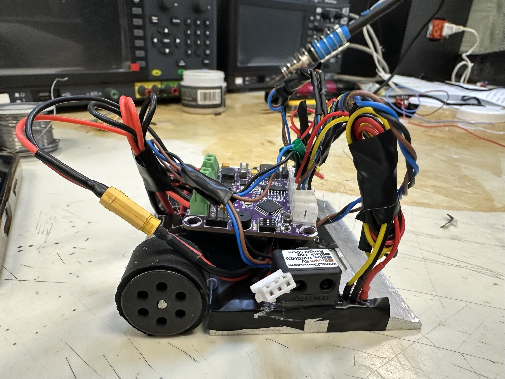
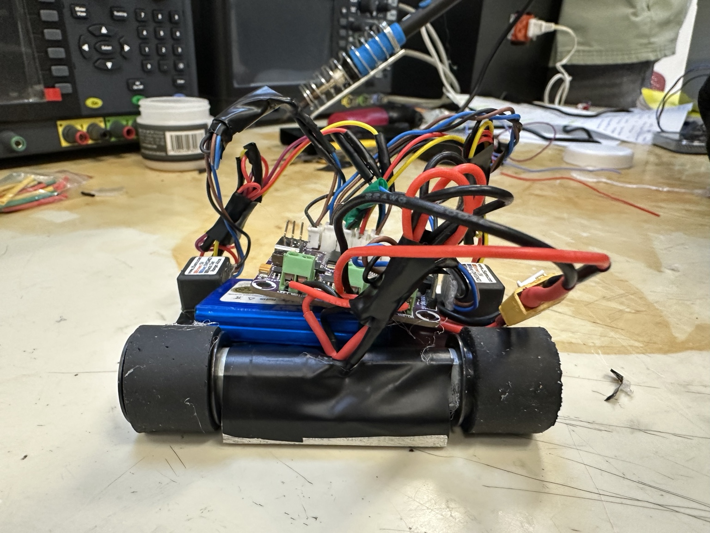
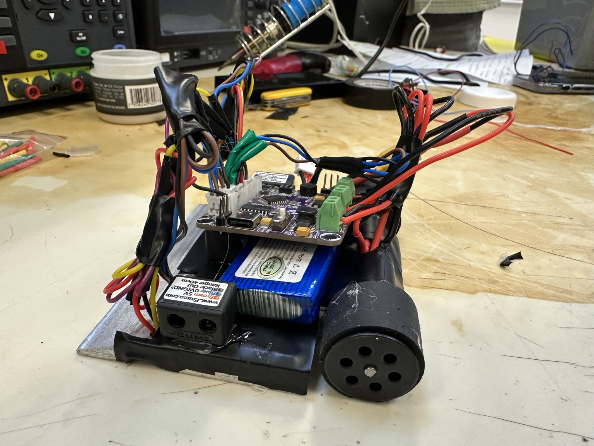
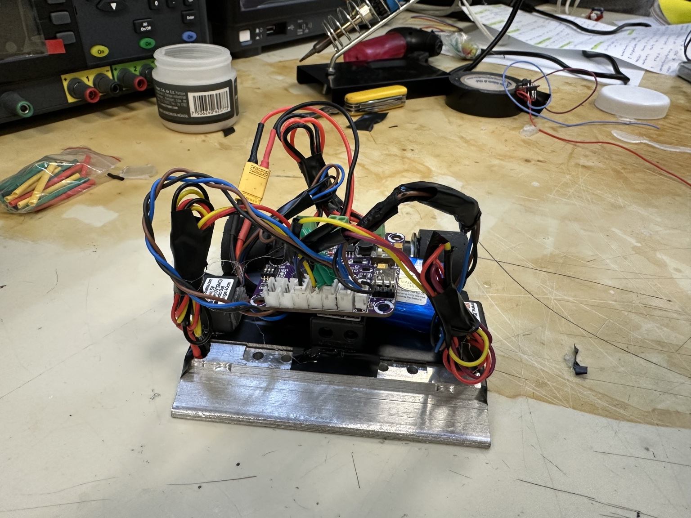

# Registro fotográfico E3 — 28 de octubre de 2026

**Equipo:** Tormenta Negra · **Misión:** mini-sumo autónomo M01.  
**Estado:** las cinco fotografías tomadas el 28 de octubre de 2026 ya están disponibles en esta carpeta con extensión `.jpg`.

| Archivo | Vista | Qué demuestra |
|---|---|---|
| `IMG_3592.jpg` | Vista superior | Chasis con base metálica, placa, batería, ruedas, cableado y módulos montados |
| `IMG_3591.jpg` | Vista lateral izquierda | Montaje de la placa sobre la estructura, rueda, cableado y sensor frontal/lateral |
| `IMG_3590.jpg` | Vista posterior | Dos ruedas motrices, batería y elementos de conexión alrededor de la placa |
| `IMG_3589.jpg` | Vista oblicua frontal | Distribución de batería, placa, sensores, ruedas y frente metálico |
| `IMG_3588.jpg` | Vista frontal | Frente de la base metálica con sensores y cableado reunido |

## Fotografías del prototipo

### 1. Vista superior

Chasis con base metálica, placa, batería, ruedas, cableado y módulos montados.

### 2. Vista lateral izquierda

Montaje de la placa sobre la estructura, rueda, cableado y sensor frontal/lateral.

### 3. Vista posterior

Dos ruedas motrices, batería y elementos de conexión alrededor de la placa.

### 4. Vista oblicua frontal

Distribución de batería, placa, sensores, ruedas y frente metálico.

### 5. Vista frontal

Frente de la base metálica con sensores y cableado reunido.

Las cinco imágenes están enlazadas en esta página y pueden consultarse directamente en GitHub.

El equipo reportó unas **cinco pruebas de sensores** sobre el dohyō y con objetos, además de aproximadamente **diez pruebas de motores** que permitieron corregir la alimentación y la polaridad. [Ver resultados y mejoras](../../datos/observaciones-dia-03.md). Las imágenes muestran cómo quedó el robot.

[Entregable E3 del equipo](../../docs/entregables/dia-03.md) · [E3 de Joel](../../participantes/A00574713/dias/E3.md) · [Índice general de evidencias](../README.md).
