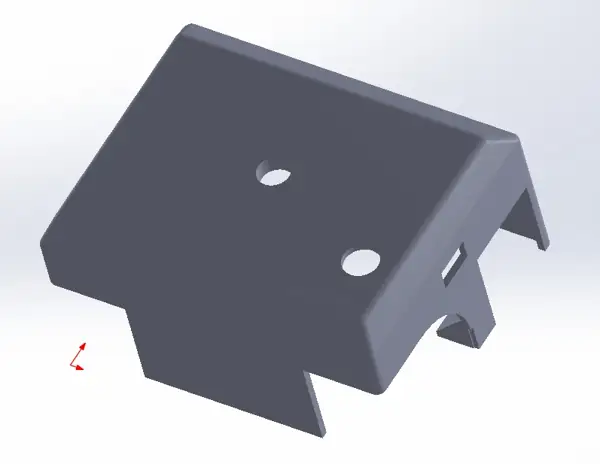
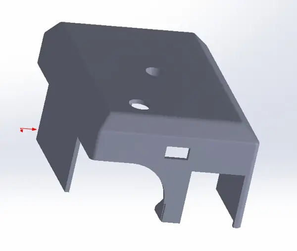

# Evidencias E4 — Día 4 · 29 de octubre de 2026

**Equipo:** Tormenta Negra · **Misión:** mini-sumo autónomo M01.

## Diseño CAD de la carcasa

**Responsable:** Claudio (`A00574802`). El Día 4 **diseñó y mandó a imprimir** la carcasa del mini-sumo. **No se instaló ni ensambló en el robot durante la sesión documentada**. La impresión se solicitó, pero no se ha confirmado su estado; el montaje es trabajo posterior.

Las dos vistas se comparten como capturas CAD **optimizadas a WebP para su visualización** (archivos originales conservados por el equipo). Son evidencia del **diseño**, no fotografías de una pieza física.

### Vista 1: perspectiva superior y lateral

### Vista 2: detalle frontal y aberturas laterales

## Más evidencias de la jornada

- **Navaja:** Sara, con apoyo de Max, la pegó al chasis. Falta enlazar una foto del resultado físico.
- **Pruebas de evasión:** tres ejecuciones a PWM 145 y tres a PWM 105. [Comparación y calibración](../../datos/e4_pruebas_pwm105_29oct.md).
- **Prueba de ataque:** el robot detectó y empujó un teléfono fuera del dohyō **al primer intento**, manteniéndose en la parte negra; se trata de una prueba con objeto, no combate oficial.
- **Dos videos:** uno del desplazamiento y otro de la expulsión del teléfono; el equipo los tiene y **falta recibir sus enlaces de Drive**.
- **Código cargado en la tarjeta de reemplazo:** [Tormenta_Negra_Final.ino](../../codigo/mini-sumo/tormenta_negra_final/Tormenta_Negra_Final.ino), sin control remoto.

[Volver al E4 colectivo](../../docs/entregables/dia-04.md) · [E4 personal de Joel](../../participantes/A00574713/dias/E4.md).
