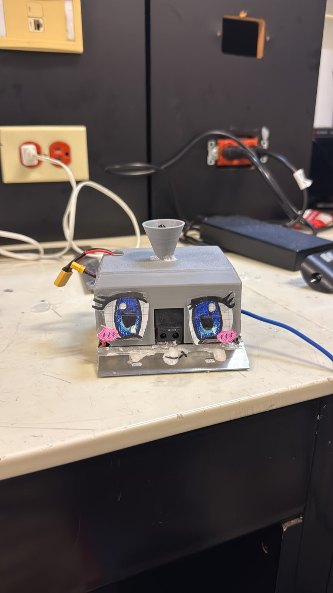
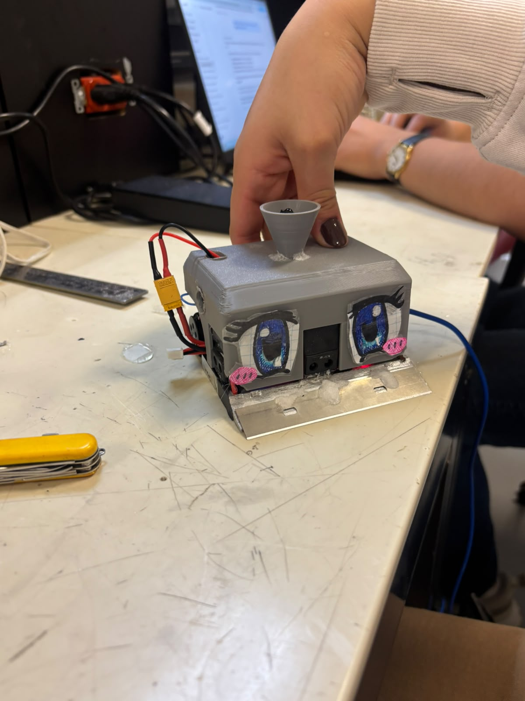

# Evidencias del Día 5 — Tormenta Negra

**Fecha:** 30 de octubre de 2026 · **Modalidad:** tres pruebas previas en el dohyō y dos peleas de minicompetencia del salón.  
**Procedencia:** duraciones, observaciones y resultados relatados por el equipo. La existencia y nombre de los cinco archivos MP4 se verificó en Google Drive, **pero su contenido visual no fue analizado directamente**. Los enlaces son los compartidos por el equipo; el acceso del profesor no se ha verificado.

## Fotografías del robot terminado

**Estado final del montaje — 30 de octubre de 2026.** Fotografías originales proporcionadas por el equipo después de la minicompetencia. Muestran la **carcasa gris impresa en 3D ya montada**, decoración frontal con ojos azules, **navaja/rampa metálica frontal**, receptor en la parte superior y conexiones exteriores visibles. Las imágenes acreditan el aspecto físico final, no mediciones de potencia o resultados adicionales.

| Fotografía | Vista | Evidencia |
|---|---|---|
|  | Frente del mini-sumo con carcasa 3D, ojos decorativos y navaja | [Abrir foto 1 — original](Tormenta_Negra_E5_final_frente.png) |
|  | Vista frontal lateral y cables de alimentación visibles | [Abrir foto 2 — original](Tormenta_Negra_E5_final_lateral.png) |

## Videos de pruebas y combates

| Intento | Tipo | Código reportado | Duración | Resultado reportado | Archivo de video |
|---:|---|---|---:|---|---|
| 1 | Prueba previa | [E5 V1](../../codigo/mini-sumo/tormenta_negra_e5_competencia/Tormenta_Negra_E5_Competencia.ino) | 13 s | Expulsó al robot del equipo de Marian; Tormenta Negra permaneció dentro | [Prueba 1.mp4](https://drive.google.com/file/d/156-m4t9S7BHtS6NTZN-u2_YC-Cp1xZfZ/view?usp=sharing) |
| 2 | Prueba previa | E5 V1 | 5 s | Esquivó al robot del equipo de Marian, que salió de la pista al esquivarlo; Tormenta Negra permaneció dentro | [Prueba 2.mp4](https://drive.google.com/file/d/18nhaoM7tSiE98WnWXMV8dTaJPr6UCGnj/view?usp=sharing) |
| 3 | Prueba previa | E5 V1 | 5 s | Detección lateral insuficiente contra robot del equipo de Marian; Tormenta Negra fue expulsado y rival permaneció dentro | [Prueba 3.mp4](https://drive.google.com/file/d/1PouI7jmeKDEtzUMt4pYGqSoV6_QFshdO/view?usp=sharing) |
| 4 | Pelea oficial del salón | [E5 V2](../../codigo/mini-sumo/tormenta_negra_e5_v2_laterales/Tormenta_Negra_E5_V2_Laterales.ino) | 10 s | **Victoria** vs. robot del equipo de Marian; contragolpe lateral expulsó al rival y Tormenta Negra permaneció dentro | [Pelea 1.mp4](https://drive.google.com/file/d/10eXbs30Vywk6ARkTiYR8rB9FN5MmFf93/view?usp=sharing) |
| 5 | Pelea oficial del salón | E5 V2 | 5 s | **Derrota** vs. robot del equipo de Marian; giro favoreció la expulsión de Tormenta Negra | [Pelea 2.mp4](https://drive.google.com/file/d/1ug7hRhPOlx5qsrZemrKEpTTV61gljSuw/view?usp=sharing) |

**Balance:** 3 pruebas previas (2 favorables, 1 parcialmente funcional que terminó con expulsión propia); 2 peleas de competencia de salón (1 victoria, 1 derrota). No deben sumarse las pruebas previas como victorias oficiales.

**Tabla de datos crudos reportados:** [e5_ensayos_30oct.csv](../../datos/e5_ensayos_30oct.csv).  
**Reporte del equipo:** [E5 colectivo](../../docs/entregables/dia-05.md).

**Actualización posterior del equipo:** los cinco intentos fueron contra el robot del equipo de Marian. En pruebas 1 y 2, Tormenta Negra permaneció dentro de la pista; en la prueba 3 el rival permaneció dentro. El profesor Camilo tuvo acceso confirmado por el equipo a los cinco videos. **Limitaciones:** los cronometrajes provienen del equipo y no se validaron cuadro a cuadro; el docente todavía no revisó los E1–E5; no consta consentimiento de difusión pública ni el commit exacto compilado en cada combate. E5 V2 fue la última versión cargada, según el equipo.
